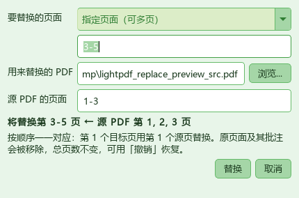

# 轻PDF编辑器 v1.0.11

> 精简版 PDF 编辑器 ｜ 基于 **PyMuPDF (MuPDF)** + **PySide6 (Qt)** ｜ 支持中文 / English
> 非官方软件，仅供学习交流，与任何商业 PDF 软件厂商均无从属或合作关系。

## 一句话

**「页面」菜单新增「替换页面...」**：用另一个 PDF 的页面替换当前文档的当前页或指定多页。
本版同时包含上一版（v1.0.10）的「保存回原文件失败」修复；界面其余部分保持现状。

> 注：本版要求目标页与源页数量相等；**v1.0.12 起已取消该限制**，详见
> [`release-notes-v1.0.12.md`](release-notes-v1.0.12.md)。

## 怎么用

1. 打开要修改的 PDF，点 **页面 → 替换页面...**（位于「从 PDF 插入页面...」和「删除页面...」之间）。
2. 选要替换的页面：**当前页**，或输入 `2-4`、`1-3,5,8-10` 这类范围一次替换多页（支持中文逗号，超出范围的页码自动忽略）。
3. 选**用来替换的 PDF**，再填它的页码。源页码会自动填成 `1-N`，一旦手动改过就不再自动覆盖；
   也允许重复同一页，例如把第 1 页同时用到 3 个目标页。
4. 对话框实时显示「将替换第 3-5 页 ← 源 PDF 第 1, 2, 3 页」。数量不一致、源文件找不到、
   源文件已加密或页码越界时，会写明原因并禁用「替换」按钮。
5. 点「替换」后，状态栏显示「已替换 N 页」。

## 规则

| 项目 | 行为 |
|---|---|
| 对应关系 | 第 k 个目标页 ← 第 k 个源页，按输入顺序一一对应 |
| 总页数 | 不变；不连续目标页、乱序源页、重复源页均支持 |
| 未涉及的页面 | 内容、旋转角度、批注原样保留 |
| 被替换的页面 | 页面本身及其批注一并移除 |
| 撤销 | 一次替换 = 一步撤销，重做可恢复 |
| 源 PDF | 只读，不会被改动；加密的源 PDF 会明确拒绝 |

常见用法：扫描件某一页扫歪了，重新扫一页存成单独 PDF，用它替换原页；或把多页 PDF 的
封面、附件页整体换成新版本。

## 实现要点

| 位置 | 改动 |
|---|---|
| `app/core/page_ops.py` | 新增 `replace_pages()`：校验数量 / 去重 / 范围后，按目标页**降序**逐页 `insert_pdf(..., annots=True)` + `delete_page()`，避免索引漂移，无需重建整棵页面树 |
| `app/ui/dialogs.py` | 新增 `ReplacePagesDialog` 与 `_parse_replace_pages()`；范围解析、源 PDF 页数探测、实时摘要与按钮门禁、源页码自动同步 |
| `app/ui/main_window.py` | 新增 `pages.replace` 动作（`convert` 图标）与 `do_replace_pages()`，接入撤销快照、视图刷新与状态栏提示 |
| `app/i18n.py` | 新增 25 条中英文词条（菜单、对话框、提示、错误原因） |

工具栏、配色、字体、控件高度、其它菜单一律未改动。

## 回归验证

`48` 项断言全部通过；上一版保存修复的 `44` 项断言重跑全绿；`app/` 全量 `compileall` 通过。

- core：单页 / 连续多页 / 不连续目标 / 乱序源页 / 同一源页重复 / 替换全部页；
  替换后保存并重新打开核对页序；未替换页的 `/Rotate 90` 与批注保留。
- 参数校验：数量不匹配、目标重复、目标或源页越界、源文件不存在、源 PDF 加密、无目标页，
  均抛出明确错误且不改动文档。
- 对话框：范围与中文逗号解析、自动同步 `1-N`、手动改写后不被覆盖、越界忽略提示、
  各类错误状态下按钮禁用、摘要文案正确。
- 主窗口：菜单项存在且位于插入与删除之间、图标正常、中英文切换、动作接线、
  替换结果、撤销与重做。
- 用现有浅绿主题实际渲染对话框截图，确认中文、控件对齐与按钮文案正常。

## 安装包说明

| 文件 | 平台 | 大小（字节） | SHA-256 |
|---|---|---|---|
| `setup.exe` | Windows 64 位 | 94,180,778 | `ca838895c0d514e30ffc7a3e468e86c0c0c9c7541d8618d565d5e12a3a05c89a` |
| `lightpdf_1.0.11_arm64.deb` | 银河麒麟 / Linux aarch64 | 待构建 | 待构建 |

- `setup.exe` 已重打包为 **1.0.11**（产品版本资源 `1.0.11`），包含上述功能与 v1.0.10 的保存修复。
- **麒麟 `.deb` 尚未重建**：仓库里现有的 `lightpdf_1.0.9_arm64.deb` 不含这两版改动。
  需在麒麟 aarch64 本机执行 `bash packaging/linux/build-kylin.sh` 生成
  `lightpdf_1.0.11_arm64.deb`；离线源码快照 `lightpdf-linux-build-1.0.11.zip` 已同步更新。
- UI 保持现状，未做任何视觉改动（用户 2026-11-13 确认）。

**完整改动**：https://github.com/feitianhang123/lightpdf/compare/v1.0.9...v1.0.11
