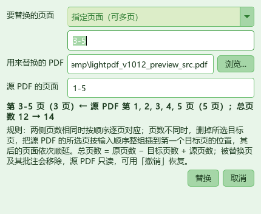
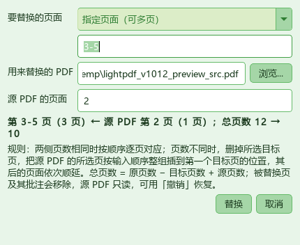

# 轻PDF编辑器 v1.0.12

> 精简版 PDF 编辑器 ｜ 基于 **PyMuPDF (MuPDF)** + **PySide6 (Qt)** ｜ 支持中文 / English
> 非官方软件，仅供学习交流，与任何商业 PDF 软件厂商均无从属或合作关系。

## 一句话

**「替换页面」不再要求两侧页数相等**：原文件可选 1 页或多页，用来替换的 PDF 也可选 1 页或多页。
多页换一页、一页换多页、多页换多页都支持，总页数随替换结果增减，其后的页面按顺序顺延。

本版同时包含 v1.0.11 的「替换页面」与 v1.0.10 的「保存回原文件失败」修复；界面其余部分保持现状。

## 怎么用

1. 打开要修改的 PDF，点 **页面 → 替换页面...**（位于「从 PDF 插入页面...」和「删除页面...」之间）。
2. 选要替换的页面：**当前页**，或输入 `3-5`、`1-3,5,8-10` 这类范围（支持中文逗号，越界页码自动忽略）。
3. 选**用来替换的 PDF**，再填它的页码，例如 `1-5`、`2`、`3,1,1`。源页码默认自动填成 `1-N`，
   一旦手动改过就不再自动覆盖；两侧页数**不必相同**，源页可乱序、可重复。
4. 对话框实时显示替换后的总页数，例如「第 3-5 页（3 页）← 源 PDF 第 1, 2, 3, 4, 5 页（5 页）；
   总页数 12 → 14」。源文件找不到、已加密、页码越界时会写明原因并禁用「替换」。
5. 点「替换」后，状态栏显示「已替换 N 页（共 X → Y 页）」。

## 规则

| 情况 | 行为 | 总页数 |
|---|---|---|
| 两侧页数**相同** | 与 v1.0.11 一致：第 k 个目标页 ← 第 k 个源页，在各自原位置替换 | 不变 |
| 目标页**多于**源页 | 删掉所有目标页，把源页整组插到第一个目标页位置，其后页面依次顺延 | 减少 |
| 源页**多于**目标页 | 删掉所有目标页，把源页按顺序整组插到第一个目标页位置，其后页面依次顺延 | 增加 |
| 通用公式 | — | 原页数 − 目标页数 + 源页数 |

例如原 12 页、目标 `3-5`（3 页）：源 `1-5`（5 页）→ 14 页，源页排在第 3~7 页，
原第 6 页及之后的内容依次接在后面；源 `2`（1 页）→ 10 页，原第 6 页及之后的内容接在新页后面。

| 项目 | 行为 |
|---|---|
| 未涉及的页面 | 内容、旋转角度、批注原样保留，相对顺序不变 |
| 被替换的页面 | 页面本身及其批注一并移除 |
| 源 PDF | 只读，不会被改动；加密的源 PDF 会明确拒绝 |
| 源页顺序 | 按输入顺序保留，可乱序、可重复同一页 |
| 撤销 | 一次替换 = 一步撤销，重做可恢复（页数变化同样可恢复） |
| 浮动对象 | 替换前先把未烘焙的图片 / 印章写进 PDF；替换后清除按旧页号登记的选择框，已写进 PDF 的图片仍可点选再编辑 |

## 实现要点

| 位置 | 改动 |
|---|---|
| `app/core/page_ops.py` | `replace_pages()` 去掉「数量必须相等」校验；页数相同时保留原降序逐页 `insert_pdf` + `delete_page`；页数不同时先在最小目标页前按顺序整组插入源页，再按 `索引 + 源页数` 降序删除原目标页，避免索引漂移 |
| `app/ui/dialogs.py` | `ReplacePagesDialog` 去掉数量不一致门禁，实时摘要新增两侧页数与「原总页数 → 新总页数」 |
| `app/ui/main_window.py` | `do_replace_pages()` 去掉数量相等校验；状态栏显示页数变化；页数变化后清理旧的浮动对象选择框 |
| `app/i18n.py` | 更新 6 条中英文词条（规则说明、摘要、源页码提示、状态栏），删除不再使用的 `dlg.replace.mismatch` |

工具栏、配色、字体、控件高度、其它菜单一律未改动。

## 回归验证

- **新增 59 项断言全部通过**：1→3 / 3→1 / 3→5 / 3→3（乱序源页）/ 不连续目标 3→2 / 源页重复与乱序 /
  替换全部页 / 等页数不连续目标仍逐页对应 / 旋转与批注保留 / 源页旋转复制 / 保存后重新打开核对页序 /
  参数校验（空目标、空源页、目标重复、目标或源页越界、源文件不存在、源 PDF 加密且失败不改动文档） /
  对话框门禁与中英文摘要 / 主窗口动作接线、状态栏、撤销与重做。
- **v1.0.10 保存修复 44 项断言重跑全绿**；`app/` 全量 `compileall` 通过。
- v1.0.11 的 48 项旧断言里 45 项仍通过，其余 3 项均为「数量不等应被拒绝」的旧预期，按本版规则已改为允许。
- 用现有浅绿主题实际渲染两张对话框截图，确认中文、控件对齐、摘要换行与按钮文案正常。

## 安装包说明

| 文件 | 平台 | 大小（字节） | SHA-256 |
|---|---|---|---|
| `setup.exe` | Windows 64 位 | 94,181,870 | `b212a02ab838b6abcfed9297c91a31602117b8b4e75e7873cb401b1f2b7ca4e4` |
| `lightpdf_1.0.12_arm64.deb` | 银河麒麟 / Linux aarch64 | 待构建 | 待构建 |

- `setup.exe` 已重打包为 **1.0.12**（内嵌 `dist\轻PDF编辑器.exe` 的 FileVersion / ProductVersion 均为
  `1.0.12`），包含上述功能以及 v1.0.10 / v1.0.11 的改动。
- **麒麟 `.deb` 尚未重建**：仓库里现有的 `lightpdf_1.0.9_arm64.deb` 不含这三版改动。
  需在麒麟 aarch64 本机执行 `bash packaging/linux/build-kylin.sh` 生成
  `lightpdf_1.0.12_arm64.deb`；离线源码快照 `lightpdf-linux-build-1.0.12.zip`（69 项，脚本已转 LF）
  已同步更新，源码内的 `app/version.py` 为 `1.0.12`。
- UI 保持现状，未做任何视觉改动（用户 2026-11-13 确认）。
- 已推送到 GitHub `main`，并发布为 **v1.0.12 Latest Release**；离线源码快照同时作为 Release 资产提供，
  方便在麒麟 aarch64 本机直接下载解压重建 `.deb`。

**完整改动**：https://github.com/feitianhang123/lightpdf/compare/v1.0.9...v1.0.12
