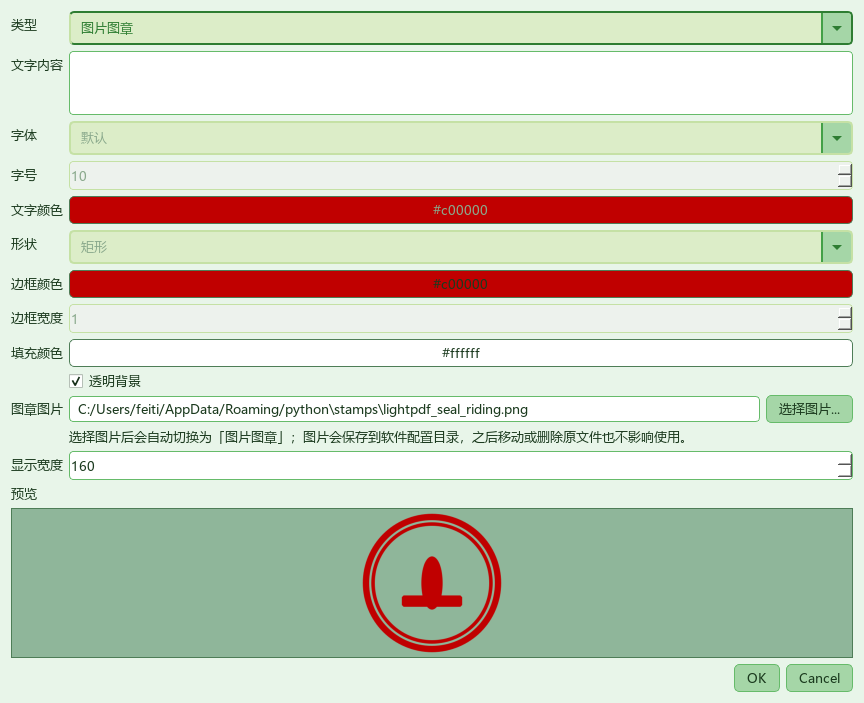
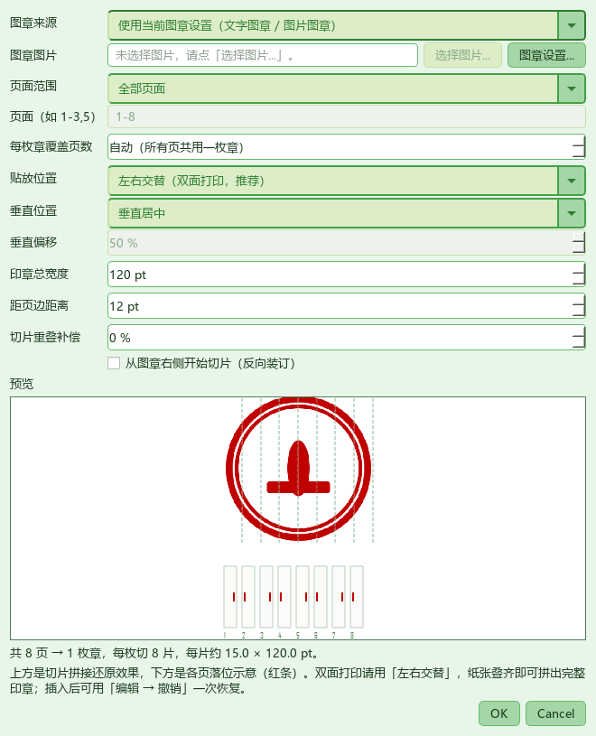
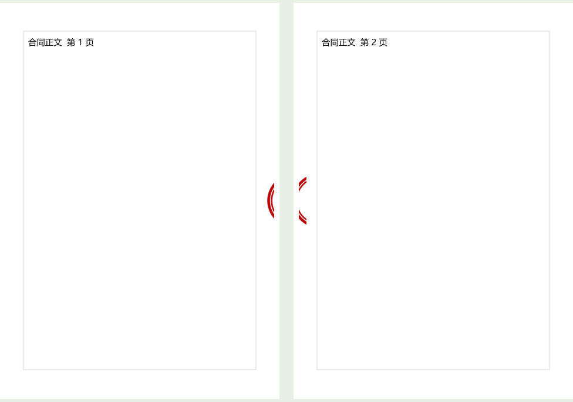

# 轻PDF编辑器 v1.0.7

> 精简版 PDF 编辑器 ｜ 基于 **PyMuPDF (MuPDF)** + **PySide6 (Qt)** ｜ 支持中文 / English
> 非官方软件，仅供学习交流，与任何商业 PDF 软件厂商均无从属或合作关系。

## 一、修复：图片图章选了 PNG 却不起作用

**现象**：在「批注 → 图章设置」里选了一张 PNG 图片图章，预览仍是原来的文字章，
点页面插入时也得不到这张图章。

**根因**（两个叠加）：

1. 「类型」下拉停在**「文字图章」**时，点「选择图片...」只会把路径填进输入框，
   **不会切换类型**；而图片输入框在文字模式下是禁用的、选择按钮却可点，用户很难意识到
   还需要再切一次类型。于是 `_collect()` 返回的 `mode` 仍是 `text`，预览与插入都走文字章。
2. 图片读取失败时 `_refresh()` 只调用了 `setText("—")`，而 `QLabel` 上**旧的 pixmap 仍在**，
   于是预览看起来"完全没变"，也不给任何错误提示。

### 改成了什么

| | 以前 | 现在 |
|---|---|---|
| 选图片 | 只填路径，类型不变 | **自动切换为「图片图章」**，手动粘贴有效路径同样生效 |
| 图片控件 | 文字模式下禁用 | 两种模式下都可用，并加了醒目说明 |
| 图片文件 | 直接引用外部路径 | **复制到软件配置目录**，移动/删除原文件不影响 |
| 图片失效 | 静默显示旧预览 | 清空预览、**显示具体原因**并禁用「确定」 |
| 插入失败 | 静默弹出设置框 | 明确提示原因，再引导去设置 |
| 读取兼容 | `QImage(path)` | `QFile` + `QImageReader`（中文路径、自动方向、更多格式） |

顺带修复了打开设置时**字体 / 形状不回显已保存值**的问题。



## 二、新增：批注 → 插入骑缝章

### 设计原理

骑缝章的本质是**一枚章、多页各占一片**：把完整印章图像按纵向平均切成 N 片，
依次贴到 N 页的页边，把打印好的纸按顺序叠齐（或翻页对齐装订边），
每一片又拼回一枚完整印章，用来证明文件没有被抽换页。

```
        完整印章                 第1页右边   第2页左边   第3页右边 …
      ┌──┬──┬──┬──┐            ┆片1┆       ┆片2┆       ┆片3┆
      │1 │2 │3 │4 │     →      ┆   ┆       ┆   ┆       ┆   ┆
      └──┴──┴──┴──┘            ┆   ┆       ┆   ┆       ┆   ┆
```

- **左右交替（双面打印，推荐）**：第 1 片贴第 1 页右侧、第 2 片贴第 2 页左侧……
  双面打印时正面右边缘与背面左边缘正好是同一条装订边，叠起来即可拼合。
- **全部贴右侧 / 左侧**：单面打印或只在纸张一侧校验时使用。
- **每枚章覆盖页数**：页数很多时，若把一枚章切成 100 片，每片只有 1 pt 宽、几乎看不见。
  可设为 10，则每 10 页共用一枚完整章，整份文档重复盖若干枚。
- **切片重叠补偿**：相邻片多取一点内容，抵消装订裁切造成的断裂。
- **反向切片**：从印章右侧开始切，适配另一种装订方向。

### 可配置参数

页面范围（全部 / 当前页到末页 / `1-3,5,8-10`）、图章来源（当前图章设置或本次另选图片）、
贴放位置、垂直位置（居中 / 上 / 下 / 自定义偏移）、印章总宽度、距页边距离、
切片重叠、反向切片。对话框实时给出**拼接还原图 + 各页落位示意**，
并显示「共 N 页 → M 枚章，每枚切 K 片，每片约 W × H pt」。





### 实现要点

- `app/ui/stamps.py`：`render_stamp_slices()` 把图章渲染成 3 倍超采样 PNG 后纵向切片，
  支持整体缩放（让宽度滑块对文字章也生效）与重叠补偿。
- `app/core/annotations.py`：`insert_riding_stamp()` 按页计算边缘矩形并贴片，
  一次插入只需一次 `push_undo()`，**「编辑 → 撤销」一步恢复全部页面**。
  对 `/Rotate 90/180/270` 的横向页，把可见坐标用 `page.derotation_matrix` 映射回
  未旋转坐标，并以相同角度预旋转切片，保证印章仍落在用户看到的边缘且方向不变。
- `app/ui/main_window.py`：新增菜单动作 `annot.riding_stamp` 与 `do_riding_stamp()`。

## 下载

| 系统 | 文件 |
|---|---|
| Windows（64 位） | `setup.exe` |
| 银河麒麟 V10 SP1 / Linux（ARM64，飞腾 / 鲲鹏） | `lightpdf_1.0.7_arm64.deb` |

> ⚠️ PyInstaller 不支持跨平台编译，麒麟安装包**必须在麒麟（aarch64）本机重新构建**：
> `bash packaging/linux/build-kylin.sh`，产物 `dist/lightpdf_1.0.7_arm64.deb`。
> 已发布的 `lightpdf_1.0.4_arm64.deb` 不含 v1.0.5 / v1.0.6 / v1.0.7 的改动。
> 也可直接把工程根目录的 `lightpdf-linux-build-1.0.7.zip` 拷到麒麟解压后构建。

## 完整性校验

| 文件 | 大小（字节） | SHA-256 |
|---|---|---|
| `setup.exe` | 94,163,853 | `f9c7763c6b7acd2863b002f26e1f463f0d0706e84616b67eb88a87f422115eeb` |

- `setup.exe` — 产品版本 **1.0.7**（Windows 64 位）

## 回归验证

- 图片图章：模拟「只选图片不切类型」→ 类型自动变为 `image`、预览变成所选印章；
  无效路径 → 预览清空并显示错误、确定按钮禁用；中文路径、PNG 解码、实际插入均通过。
- 切片：8 页文档 → 8 片，每片 15 × 120 pt；前 4 页与后 4 页分组、重叠 10%、
  反向切片、全部贴右侧 + 顶部对齐，几何断言全部通过。
- 旋转页：`/Rotate` 为 0 / 90 / 180 / 270 时渲染后均能在可见右边缘找到印章像素。
- 端到端：主窗口菜单 → 8 页各插入 1 个切片 → 一次撤销全部消失 → 重做全部恢复；
  普通图片图章点击插入同时复测通过；`app/` 全量 `compileall` 通过。

**完整改动**：https://github.com/feitianhang123/lightpdf/compare/v1.0.6...v1.0.7
