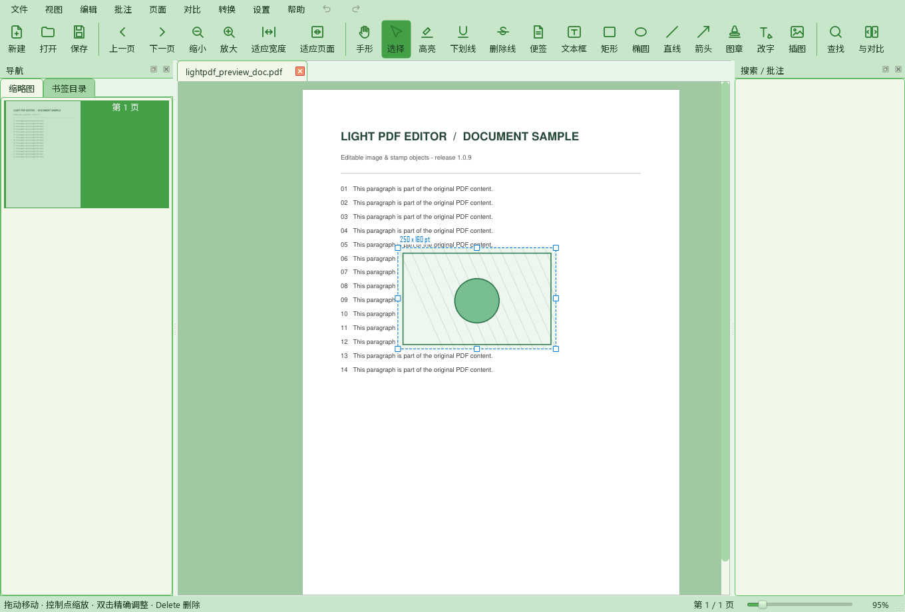
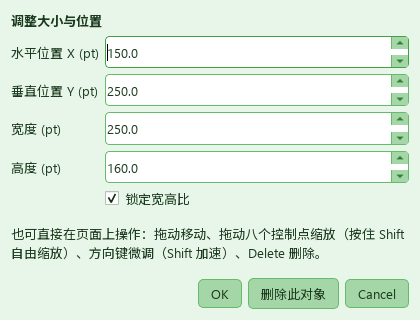
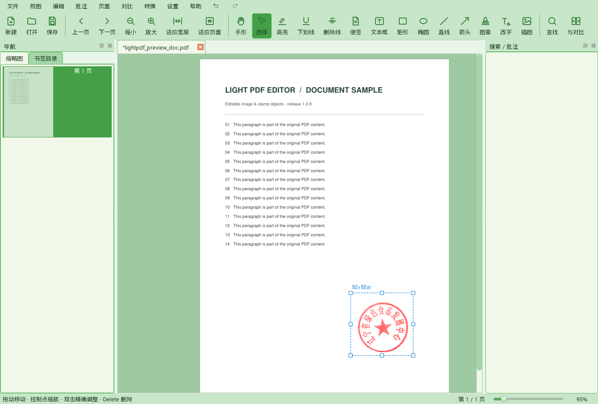

# 轻PDF编辑器 v1.0.9

> 精简版 PDF 编辑器 ｜ 基于 **PyMuPDF (MuPDF)** + **PySide6 (Qt)** ｜ 支持中文 / English
> 非官方软件，仅供学习交流，与任何商业 PDF 软件厂商均无从属或合作关系。

## 一句话

**插入的图片可以改大小，插入的印章可以挪位置**——两者现在统一为「可编辑浮动对象」，
插完就能选中、拖动、缩放、精确设数值，保存后重新打开也还能再调。

## 1. 插入图片后调整大小

以前图片插入后其实可以拖四角缩放，但**没有任何可视提示**，四角命中区也藏在图片边缘，
实际使用几乎找不到；而且一旦保存、图片被写进 PDF，就再也选不中了。本版：

- 插入后**自动选中**，显示蓝色虚线框、**8 个白色控制点**和实时尺寸标签（如 `250 x 160 pt`）。
- 拖动图片本体 → 移动；拖动四角 → 按原比例缩放；拖动四边 → 单向拉伸；
  按住 `Shift` 拖动 → 自由缩放（不锁比例）。
- 「编辑 / 批注 → 调整图片 / 印章...」或**双击对象**打开数值对话框：
  X / Y 位置、宽度、高度、「锁定宽高比」开关、「删除此对象」按钮。
- `Delete` 删除选中对象；方向键微调 1pt，`Shift` + 方向键 10pt。
- 移动、缩放、删除、数值修改都接入撤销 / 重做（一次交互一步撤销）。

## 2. 插入印章后调整位置

以前点一下页面就把图章 `page.insert_image()` **立刻烙进 PDF**，之后无法选中
（它不是 `Annot`，`page.annots()` 根本找不到）。本版：

- 单枚图章改成与图片相同的**浮动对象**：落位后自动切到「选择」工具，
  直接拖动即可移动，也能缩放、精确设坐标或删除；在**保存 / 打印 / 导出**时才写入 PDF。
- 「图章」工具仍处于激活状态时，点已有图章会选中它而不是再盖一枚新的。
- 已经写进 PDF 的图片 / 印章（旧文件、保存后重开、其它软件生成的图片）也能**再次点选调整**：
  - 单击只选中、不改文档；真正拖动 / 改数值 / 删除时才把它从页面内容流中摘出，变成浮动对象。
  - 用 `page.get_image_info(xrefs=True)` 定位实例，`delete_image(xref)` + 重组 SMask 透明通道还原原图；
    同一 xref 被复用到多个位置时，其它位置会自动按原矩形重插，不会被误删。
  - 删除 `delete_image` 留下的 1×1 透明占位图，以及占满整页的扫描背景图，不会被误当成可编辑对象。
- 旋转页（`/Rotate 90 / 180 / 270`）的显示坐标 ↔ PDF 坐标换算修正：
  浮动对象统一以**显示坐标**保存，烘焙时用 `derotation_matrix` 换算并按页旋转预旋转图片；
  缩放页面（0.1x ~ 8x）后控制点随之重建。

骑缝章仍按原方式一次生成多页切片；每片也是图片对象，同样可再次点选微调。

## 实现要点

| 位置 | 改动 |
|---|---|
| `app/core/editor.py` | `list_image_objects` / `image_object_bytes`（含 alpha 还原）/ `lift_image_object`（含重复 xref 保护）；`insert_image_bytes` 新增 `rotate` |
| `app/ui/pdf_view.py` | 浮动对象统一模型、选中框与 8 控制点、八向缩放、烘焙坐标换算、烘焙对象再选中、键盘操作、一次性撤销快照 |
| `app/ui/dialogs.py` | `ObjectPropertiesDialog`（X / Y / 宽 / 高 / 锁定比例 / 删除） |
| `app/ui/document_tab.py` | 撤销快照同时保存浮动对象状态，undo / redo 一并恢复 |
| `app/ui/main_window.py` | 图章改为浮动插入；插图后自动选中；新增菜单命令与精确调整对话框接线；状态栏操作提示 |
| `app/i18n.py` | 中英文词条 15 条 |

## 回归验证

- 三套 offscreen 回归：对象模型 / 主窗口接线 / 真实鼠标事件，共 40+ 断言全部通过。
- 控制点命中：8 方向逐个验证；四角与四边缩放数学、锁比例 / 自由缩放、对角锚点、最小 12pt 限制。
- 撤销 / 重做：插入 → 移动 → 删除 → 逐步撤销至空 → 重做恢复。
- 旋转页：`/Rotate 0/90/180/270` 逐一烘焙，断言 `bbox * rotation_matrix == 显示矩形`，并做像素着色检查。
- 保存后重选：选中不改动文档像素；材质化后原位清除、新位着色；同一 xref 的第二个实例保留。
- 烘焙后无残留预览图元（`zValue=5` 的 `QGraphicsPixmapItem` 数量归零）。
- `app/` 全量 `compileall` 通过；`retranslate()` 中英文切换正常。

## 安装包说明

- **Windows**：`setup.exe` 已重打包为 **1.0.9**（产品版本资源 `1.0.9`），包含上述全部改动。

  | 文件 | 大小（字节） | SHA-256 |
  |---|---|---|
  | `setup.exe` | 94,173,010 | `be869c4ea0ee3bb2e0eedc90260ae29f74c3bf45b37f41471d94fa85fc947a4c` |

- **银河麒麟 / Linux aarch64**：需在麒麟本机执行 `bash packaging/linux/build-kylin.sh`
  重新构建 `lightpdf_1.0.9_arm64.deb`；仓库中现有的 `lightpdf_1.0.8_arm64.deb`
  **不含本版改动**。离线源码快照 `lightpdf-linux-build-1.0.9.zip`（63 项）已同步更新。
